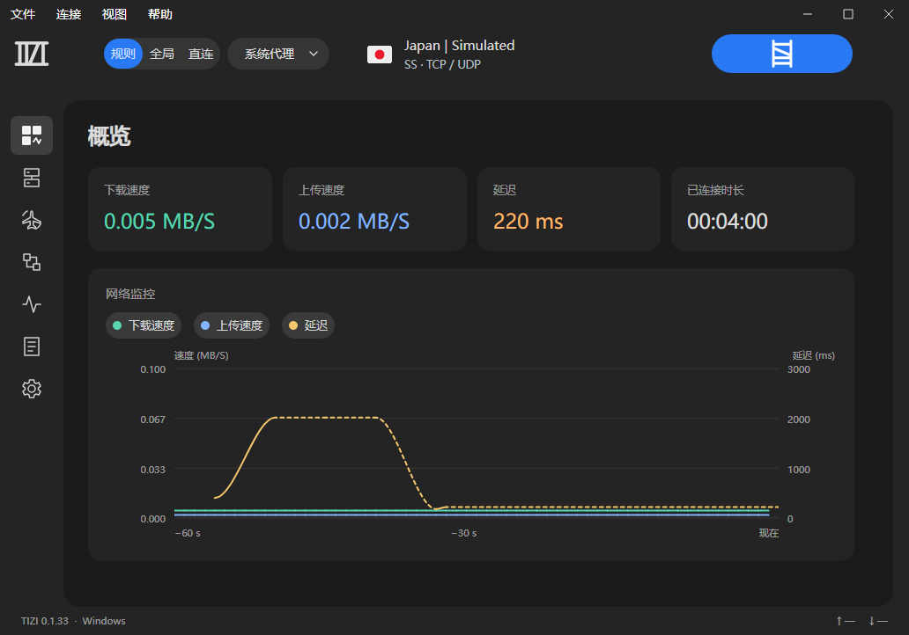

# TIZI

TIZI 是面向 Windows 的代理客户端，提供节点与订阅管理、分流规则、网络监控和机场导航。

[下载 TIZI 0.1.44](https://github.com/IZILE/TIZI/releases/tag/v0.1.44) · [更新说明](CHANGELOG.md) · [订阅导入说明](docs/SUBSCRIPTIONS.md)

- 链接、网址、二维码图片、剪贴板、JSON、Clash YAML 和部分 Shadowrocket .conf 导入；兼容单条 Shadowrocket 订阅 JSON、`.url` / `sub://` 和带状态说明的订阅列表，详见 [订阅导入说明](docs/SUBSCRIPTIONS.md)。
- JSON / YAML、常见协议分享链接、二维码及订阅地址导出。
- 订阅和节点在同一页管理，显示到期日、用量、国家与 TCP / UDP 信息。
- 用播放三角形、旋转弧线、完整梯子和红色断裂梯子表示连接状态；连接成功时，旋转线分段搭建为纵向梯子。
- 下载、上传实时曲线；延迟曲线默认关闭，手动开启后每秒采集，支持图例切换和鼠标查看数值。
- 未连接时可测试节点延迟；HTTP 测试使用临时本地内核，结束后清理。
- 可选节点超时自动切换，默认关闭；仅切换到检测成功的同国家／地区节点，无同地区可用节点则保持当前节点。详见 [自动切换说明](docs/NODE-FAILOVER.md)。
- 内容项单击选择、双击或 Enter 执行，右键管理；移除有撤销，订阅移除说明节点范围。
- 长按内容项直接进入多选，逐项点击加入或取消选择；工具栏末端按钮鼓出红色移除按钮，经过粘连、拉细和断开后分离。
- 节点、机场和分流规则支持本地搜索；机场详情在主窗口内展示并随窗口大小适配。
- 常规页选项修改后自动保存；需要输入和校验的设置保留草稿与保存入口，彻底退出前提示未保存更改。
- 应用内弹层从触发按钮展开到主窗口中央，点击外部空白或 Esc 收回；保存期间保留写入保护。
- 概览延迟数值默认更新，曲线手动开启后才增加频率；节点批量测试保持独立。
- 配置读取失败有恢复入口，保存前保留加密备份，可合并缺失订阅、节点与规则。
- 托盘、可选登录启动、关闭行为与上次连接状态恢复。
- 机场搜索复用保存的条件，支持独立取消与重试，综合已有排名和使用者评价，最多缓存 100 项。
- 分区设置涵盖隧道、TCP / UDP、DNS 与诊断，日志按代理、DNS 和应用分类。
- 日志仅排版可见区域的记录，保留完整分类复制、滚动位置和文本片段选择。
- 连接节点后自动检测出口 IP；仅以紧凑标签显示已知的网络类型与原生 IP 参考结果，不确定项隐藏，悬停可查看来源与判定依据，详情见 [IP 检测说明](docs/IP-QUALITY.md)。

安装程序允许选择目录，默认安装到当前用户的 `C:\Users\<用户名>\AppData\Local\Programs\TIZI`。运行不需要另装 .NET。首次启动保持断开；后续可恢复退出时的连接状态。

支持程度与使用方法见 [安装与使用说明](docs/INSTALLING.md) 和 [功能对照](docs/FEATURES.md)。构建方法见 [BUILDING.md](BUILDING.md)。此版本仍需真实桌面与实际网络环境验证。机场信息展示可追溯的公开评价和排名，不提供自创的安全或 IP 质量评分。

## 界面预览

